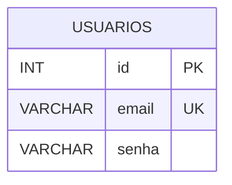
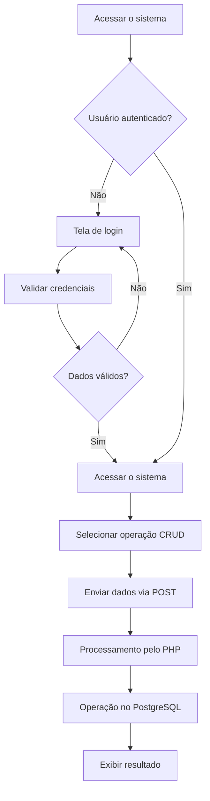

# Mini Sistema: Gerenciamento de Alunos.

## CRUD Utilizando HTML + PHP + POSTGRESQL

### Objetivos:

1. Cadastrar Aluno:
- Receber Nome, Turma, Nascimento, Ativo.

2. Excluir Aluno:
- Excluir um aluno a partir do ID.

3. Relatório:
- Listar todos os alunos cadastrados no sistema.

4. Consultar Aluno:
- Consultar um aluno específico a partir do ID.

5. Atualizar Aluno:
- Atualizar aluno a partir do ID.

### Sistema de Login

1. Criar tabela de usuários.

2. Cadastrar usuários.

3. Criar login.

4. Verificar se os usuários são válidos em todas as páginas restritas.

## 1. Gerenciamento de Alunos

### 01 — Cadastrar Aluno

Permitir o cadastro de alunos por meio de um formulário contendo os seguintes campos:

- Nome;
- Turma;
- Nascimento;
- Ativo.

Os dados devem ser enviados utilizando o método POST, processados pelo PHP e armazenados no banco de dados PostgreSQL.

### 02 — Excluir Aluno

Permitir a exclusão de um aluno a partir do seu ID.

O sistema deve localizar o registro correspondente no banco de dados e executar a exclusão caso o aluno exista.

### 03 — Relatório de Alunos

Listar todos os alunos cadastrados no banco de dados, apresentando suas informações para consulta.

### 04 — Consultar Aluno

Permitir a consulta de um aluno específico a partir do seu ID.

Caso o aluno seja encontrado, suas informações devem ser apresentadas. Caso contrário, o sistema deve informar que o registro não foi localizado.

### 05 — Atualizar Aluno

Permitir a atualização dos dados de um aluno cadastrado, utilizando seu ID para identificar o registro.

O sistema deve possibilitar a alteração das informações e salvar as modificações no banco de dados.

## 2. Sistema de Login

### 06 — Tabela de Usuários

Criar uma tabela para armazenar os dados dos usuários responsáveis pelo acesso ao sistema.

#### Descrição dos campos

- `id`: identificador único do usuário.
- `email`: e-mail utilizado para realizar o login.
- `senha`: senha do usuário, armazenada preferencialmente em formato de hash.

### 07 — Cadastro de Usuários

Permitir o cadastro de novos usuários no sistema, recebendo e-mail e senha por meio de um formulário.

O sistema deve verificar se os dados são válidos e impedir o cadastro de e-mails duplicados.

As senhas devem ser armazenadas utilizando mecanismos de hash, como `password_hash()` do PHP.

### 08 — Login

Criar uma página de login para autenticar os usuários cadastrados.

O sistema deve:

1. Receber o e-mail e a senha informados.
2. Consultar o usuário no banco de dados.
3. Verificar se a senha corresponde à senha cadastrada.
4. Iniciar uma sessão após a autenticação bem-sucedida.
5. Permitir o acesso às páginas restritas.

Caso as credenciais sejam inválidas, o acesso deve ser negado.

### 09 — Validação de Usuários nas Páginas

Verificar a autenticação do usuário em todas as páginas restritas do sistema.

Caso um usuário não autenticado tente acessar diretamente uma dessas páginas, deverá ser redirecionado para a página de login.

A validação deve ser realizada no servidor, utilizando sessões do PHP.

### 10 — Logout

Permitir que o usuário encerre sua sessão, invalidando os dados de autenticação e impedindo o acesso às páginas restritas até que um novo login seja realizado.

## 3. Banco de Dados

### Tabela alunos

| Campo | Tipo | Descrição |
|---|---|---|
| id | SERIAL | Identificador único do aluno |
| nome | VARCHAR | Nome do aluno |
| turma | VARCHAR | Turma do aluno |
| nascimento | DATE | Data de nascimento |
| ativo | BOOLEAN | Situação do aluno |

### Tabela usuarios

| Campo | Tipo | Descrição |
|---|---|---|
| id | SERIAL | Identificador único do usuário |
| email | VARCHAR(60) | E-mail para autenticação |
| senha | VARCHAR(255) | Hash da senha |

## 4. CRUD

| Operação | Descrição | Comando SQL |
|---|---|---|
| Create | Cadastrar um aluno | INSERT |
| Read | Consultar ou listar alunos | SELECT |
| Update | Atualizar dados de um aluno | UPDATE |
| Delete | Excluir um aluno | DELETE |

### Como funciona

## 5. Tecnologias Utilizadas

- HTML: estruturação das páginas e formulários.
- PHP: processamento das requisições, regras de negócio e autenticação.
- PostgreSQL: armazenamento e gerenciamento dos dados.
- SQL: manipulação dos registros no banco de dados.
- HTTP POST: envio de dados dos formulários ao servidor.
- Sessões PHP: controle da autenticação dos usuários.
- Git e GitHub: versionamento e hospedagem do código-fonte.
